<p align="center">
  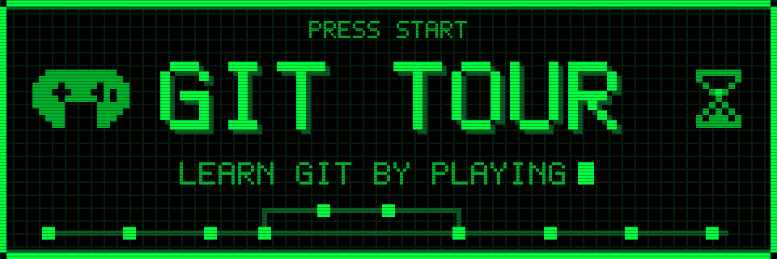
</p>

<p align="center">
  <b>Ek browser-based game jo Git sikhata hai</b> — fake terminal mein commands type karo,<br/>
  live commit graph dekho, timelines repair karo.<br/>
  <b>No backend, no real Git — kuch bhi nahi tootega.</b>
</p>

<p align="center">
  <a href="https://gittour.vercel.app/">
    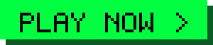
  </a>
</p>

<p align="center">
  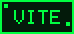
  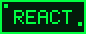
  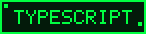
  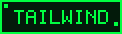
  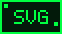
  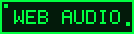
  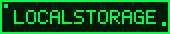
  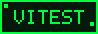
</p>

<p align="center">
  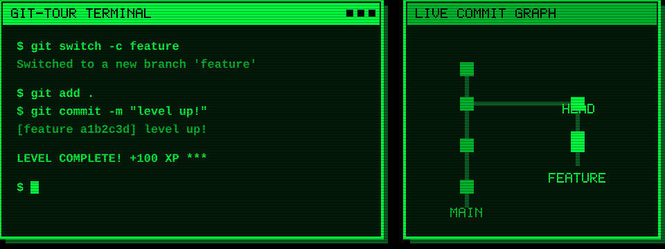
</p>

<a name="contents"></a>


<p align="center">
  <a href="#about">About</a> ·
  <a href="#features">Features</a> ·
  <a href="#how-to-play">How to play</a> ·
  <a href="#tech">Tech</a> ·
  <a href="#quick-start">Quick start</a> ·
  <a href="#scripts">Scripts</a> ·
  <a href="#deploy">Deploy</a> ·
  <a href="#architecture">Architecture</a> ·
  <a href="#add-command">Add a command</a> ·
  <a href="#add-level">Add a level</a> ·
  <a href="#add-badge">Add a badge</a> ·
  <a href="#design">Design choices</a> ·
  <a href="#testing">Testing</a> ·
  <a href="#contributing">Contributing</a> ·
  <a href="#troubleshooting">Troubleshooting</a> ·
  <a href="#credits">Credits</a>
</p>

---

<a name="about"></a>


<p align="center">
  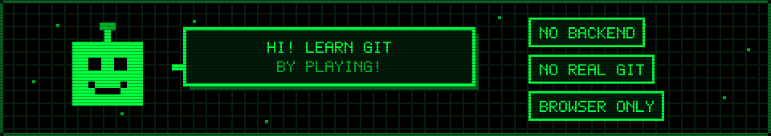
</p>

**Git Tour** ek game hai jisme tum Git commands ek **fake terminal** mein type karte ho, aur har command ka asar **live commit graph** par dekhte ho. Levels mein toote hue timelines (branches, commits, merges) ko repair karna hota hai.

Poora game browser mein chalta hai. Koi server nahi, koi real Git nahi — isliye tum jo bhi try karo, **kuch bhi nahi tootega**. Galti ho gayi? Level reset karo aur phir se khelo.

Live version: **https://gittour.vercel.app/**

<a name="features"></a>


<p align="center">
  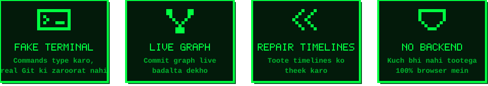
</p>

- **CRT-style fake terminal** — real Git jaisi commands, help aur tab-completion ke saath.
- **Live commit graph** — SVG graph jo har command ke baad update hota hai.
- **Levels in worlds** — story, explanation aur task ke saath, boss levels bhi.
- **Hints** — 3 steps: chhota hint, bada hint, aur solution.
- **XP, stars, badges, streak** — progress aur rewards.
- **Sound effects** — Web Audio se generate hote hain, koi audio file nahi.
- **Progress saved** — `localStorage` mein, browser band karne ke baad bhi.
- **Mobile friendly** — animations `transform`/`opacity` se, aur `prefers-reduced-motion` respect hota hai.

<a name="how-to-play"></a>


<p align="center">
  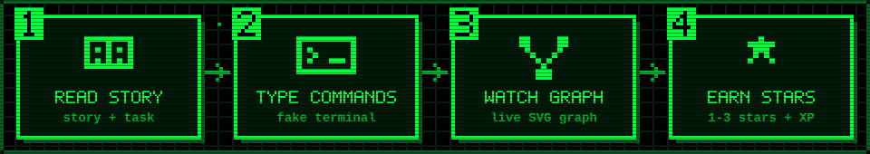
</p>

1. **Story padho** — level ka story, explanation aur task samjho.
2. **Commands type karo** — terminal mein Git commands chalao (jaise `git add`, `git commit`, `git switch`, `git merge`).
3. **Graph dekho** — har command ke baad commit graph aur areas panel badalte hain.
4. **Goal poora karo** — win check **state-based** hai: final repo goal se match kare to level complete, chahe tumne koi bhi raasta liya ho.
5. **Stars kamao** — **no hints + par commands ke andar = 3★**.

<a name="tech"></a>


<p align="center">
  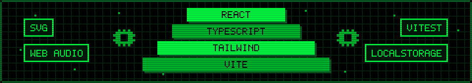
</p>

**Vite + React + TypeScript + Tailwind + SVG + Web Audio + localStorage.** Tests: Vitest.

<a name="quick-start"></a>


<p align="center">
  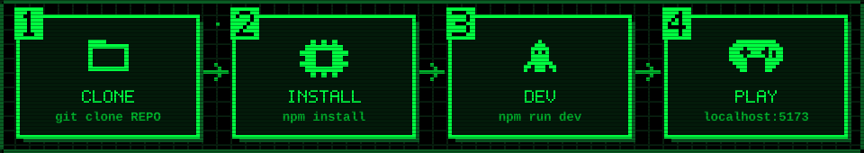
</p>

**Prerequisites:** Node.js 18+ aur npm.

```bash
# 1. Clone
git clone <your-repo-url>
cd gittour

# 2. Install
npm install

# 3. Run
npm run dev      # http://localhost:5173
```

Browser mein `http://localhost:5173` kholo — bas, game ready hai.

<a name="scripts"></a>


<p align="center">
  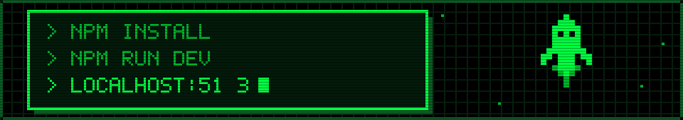
</p>

```bash
npm install
npm run dev      # http://localhost:5173
npm test         # Vitest (engine + levels)
npm run build    # dist/ ready for Vercel / GitHub Pages
```

| Command | Kya karta hai |
|---|---|
| `npm install` | Dependencies install karta hai |
| `npm run dev` | Dev server chalata hai (`http://localhost:5173`) |
| `npm test` | Vitest se engine aur levels ke tests chalata hai |
| `npm run build` | `dist/` mein production build banata hai |

<a name="deploy"></a>


<p align="center">
  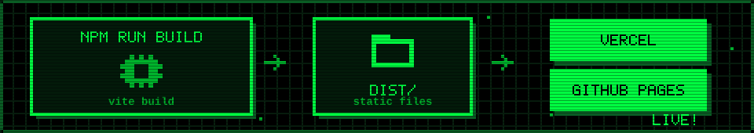
</p>

Game ek static site hai (no backend), isliye kahin bhi host ho jata hai.

**Vercel**
1. Repo ko Vercel mein import karo.
2. Framework preset: **Vite**.
3. Build command: `npm run build`, output directory: `dist`.

**GitHub Pages**
1. `npm run build` chalao.
2. `dist/` ko Pages par publish karo.
3. Agar site subpath par hai (`username.github.io/gittour/`), to `vite.config` mein `base: '/gittour/'` set karo.

<a name="architecture"></a>


<p align="center">
  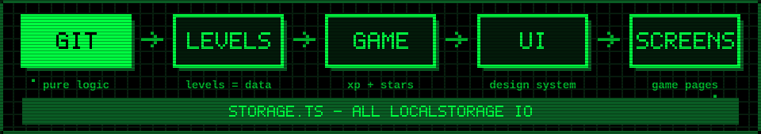
</p>

*Why it looks like this:*

```
src/git/       → pure Git engine. NO React imports. 100% testable.
src/levels/    → levels are DATA; checker compares final STATE to goal (not commands).
src/game/      → XP, stars, badges, streak, sound.
src/ui/        → design-system components (Button, Panel, Modal...).
src/screens/   → Title, WorldMap, Level, LevelComplete, BossIntro, Profile.
src/components/→ Terminal (CRT), CommitGraph (SVG), AreasPanel, HUD, Mascot.
src/storage.ts → ALL localStorage I/O in one file, try/catch wrapped.
```

<a name="add-command"></a>


<p align="center">
  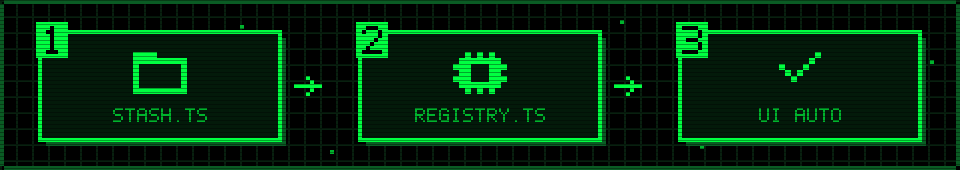
</p>

Example: `git stash`

**1.** Create `src/git/commands/stash.ts`:

```ts
import type { CommandDef } from '../types'
export const stash: CommandDef = {
  name: 'stash',
  description: 'Changes ko temporarily side mein rakho.',
  usage: 'git stash',
  examples: ['git stash'],
  execute(args, ctx) {
    // mutate ctx.repo, return lines
    return { kind: 'success', lines: ['Changes stashed!'] }
  },
}
```

**2.** Register it in `src/git/registry.ts`:

```ts
import { stash } from './commands/stash'
// commands array mein add karo: stash,
```

**3.** (Optional) Test in `src/git/git.test.ts`. Bas — UI, help, aur tab-completion automatic pickup karte hain.

> **Note:** flags (jaise `-m`) registry `ctx.flagBag` mein daalta hai; args ke bina `git commit -am` wale commands `ctx.flagBag ?? []` padho.

<a name="add-level"></a>


<p align="center">
  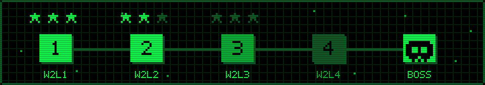
</p>

`src/levels/levels.ts` mein ek object add karo:

```ts
{
  id: 'w2l5', world: 2, title: 'Merge Marathon',
  storyHinglish: '...', explanationHinglish: '...', task: '...',
  startState: { repo: { initialized: true, workdir: {...}, commits: {...}, branches: {...}, head: { kind: 'branch', name: 'main' } } },
  goal: { minCommits: 3, headBranch: 'main', cleanTree: true },  // STATE-based check
  hints: ['small', 'bigger', 'solution'],
  allowedCommands: ['branch', 'switch', 'merge', 'add', 'commit', 'status', 'log'],
  parCommands: 4, isBoss: false,
}
```

Star rating automatic hai: **no hints + ≤ `parCommands` = 3★** (see `src/levels/scoring.ts`).

<a name="add-badge"></a>


<p align="center">
  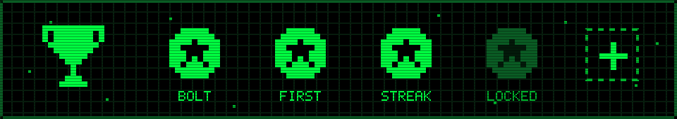
</p>

`src/game/achievements.ts`:

```ts
{ id: 'my-badge', name: 'My Badge', desc: 'Kya kiya isse milta hai.', icon: 'bolt' }
```

Unlock condition `checkBadges()` (tests) aur `computeBadges()` (`src/App.tsx`) dono mein add karo.

<a name="design"></a>


<p align="center">
  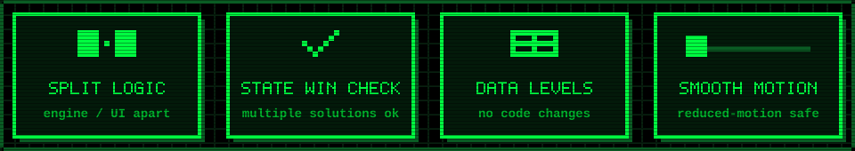
</p>

- **Engine/UI separation** — testability.
- **State-based win checking** — multiple solutions allowed.
- **Data-driven levels** — add without touching code.
- **Transform/opacity-only animation** — mobile-friendly, aur `prefers-reduced-motion` globally respect hota hai.

<a name="testing"></a>


<p align="center">
  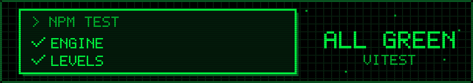
</p>

```bash
npm test
```

Vitest engine (`src/git/`) aur levels dono ko test karta hai. Naya command ya level add karo to uska test bhi likho — engine pure hai (no React), isliye tests fast aur simple rehte hain. Badge unlock logic bhi `checkBadges()` ke through tests mein cover hota hai.

<a name="contributing"></a>


<p align="center">
  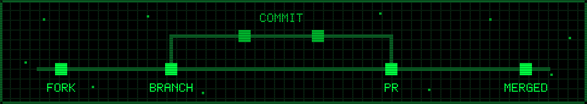
</p>

1. Repo **fork** karo aur clone karo.
2. Naya branch banao: `git switch -c my-feature`
3. Changes karo (naya command, level ya badge — upar ke guides dekho).
4. `npm test` aur `npm run build` chalao, dono pass hone chahiye.
5. Commit karo aur **Pull Request** kholo.

<a name="troubleshooting"></a>


<p align="center">
  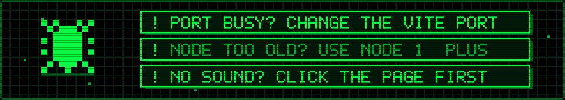
</p>

| Problem | Fix |
|---|---|
| `5173` port busy hai | Dusra process band karo, ya Vite ka port badlo (`npm run dev -- --port 3000`). |
| Install / build error | Node.js 18+ use karo, phir `node_modules` delete karke `npm install` dobara chalao. |
| Sound nahi aa raha | Browsers audio tab tak block karte hain jab tak tum page par click na karo. Ek baar click karo. |
| Progress reset ho gaya | Progress `localStorage` mein hota hai. Private window ya browser data clear karne par reset hota hai. |

<a name="credits"></a>


<p align="center">
  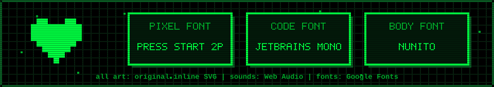
</p>

All art is original inline SVG; sounds are generated with Web Audio. Fonts: Press Start 2P / JetBrains Mono / Nunito via Google Fonts.

<p align="center">
  
</p>

<p align="center">
  <sub><code>$ git commit -m "game over? nahi — continue?"</code></sub>
</p>
